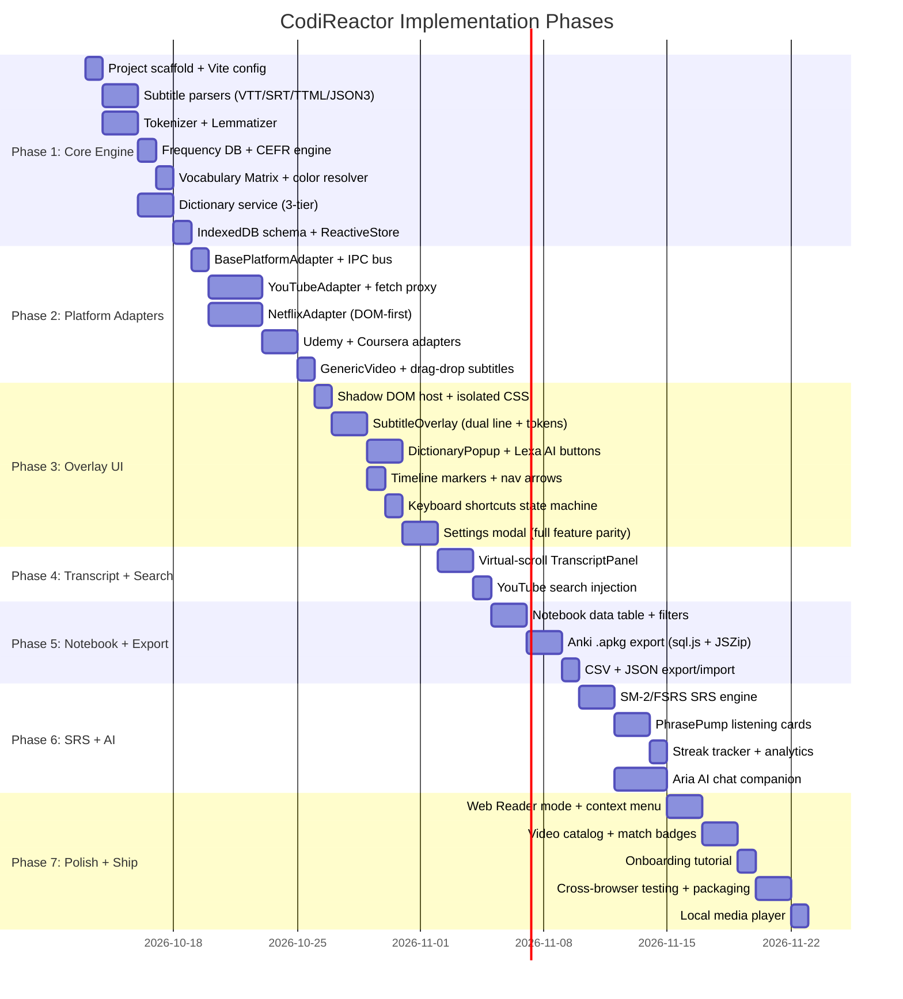

# CodiReactor: Universal Language Immersion & Subtitle Engine
## Engineering Architecture Specification & Implementation Plan — v2.0

> **Product Code:** `CodiReactor`  
> **Status:** APPROVED ENGINEERING SPECIFICATION (v2.0 — Revised)  
> **Target Platforms:** YouTube, Netflix, Udemy, Coursera, Generic HTML5 Video, Web Articles & Local Media  
> **Delivery Formats:** Manifest V3 Cross-Browser Extension (Chrome, Edge, Brave, Firefox) + Desktop Web/Tauri Media Hub  
> **Reference Benchmark:** Language Reactor (`CodiReactor/ref/*`)  
> **Last Updated:** 2026-10-12

---

## 1. Executive Summary & Problem Definition

`CodiReactor` is a production-grade, multi-platform language immersion engine. It transforms any video, web article, or custom text into an interactive language learning environment by intercepting, parsing, tokenizing, and enriching content in real-time — overlaying interactive linguistic data directly onto the host surface.

### 1.1 Core Value Proposition

```
┌──────────────────────────────────────────────────────────────────────────────────────────────────┐
│                                   CODIREACTOR CORE VALUE PROP                                    │
├──────────────────────────┬──────────────────────────────┬────────────────────────────────────────┤
│ 1. UNIVERSAL ADAPTERS    │ 2. TOKEN-LEVEL IMMERSION     │ 3. ACTIVE SRS RETENTION               │
│ • YouTube TimedText      │ • Per-word color classes      │ • PhrasePump SRS engine (SM-2/FSRS)   │
│ • Netflix DOM + Manifest │ • CEFR & frequency grading    │ • One-click sentence mining            │
│ • Udemy (video.js)       │ • Instant IPA + definitions   │ • Anki .apkg + CSV + JSON export       │
│ • Coursera (React)       │ • Lexa AI context explainers  │ • Contextual audio replay              │
│ • Web Articles & eBooks  │ • Dual subtitles (Target+L1)  │ • Aria AI conversation hub             │
│ • Local media files      │ • RTL + CJK full support      │ • GitHub-style streak tracker          │
└──────────────────────────┴──────────────────────────────┴────────────────────────────────────────┘
```

### 1.2 Technical Constraints & Non-Negotiables

| Constraint | Requirement |
|---|---|
| **Host Site Immunity** | Must never break host player, click handlers, or DRM playback |
| **Time Sync Latency** | Subtitle updates ≤ 16ms of video time change (single frame budget) |
| **Shadow DOM Isolation** | Zero CSS leak into/out of `#codireactor-root` |
| **Offline Autonomy** | Core subtitle + dictionary + vocabulary + SRS must work 100% offline |
| **Data Ownership** | All user data in local IndexedDB with unrestricted export |
| **Bundle Size** | Extension ≤ 8MB (CWS recommendation), core overlay ≤ 200KB JS |
| **Startup Time** | Content script injection to first subtitle render ≤ 500ms |
| **Memory** | Overlay + tokenizer ≤ 30MB RAM per tab |
| **Accessibility** | WCAG 2.1 AA for all interactive elements |

---

## 2. In-Depth Reference Feature Study

Based on analysis of 21 reference screenshots in `CodiReactor/ref/`:

### 2.1 Video Screen Subtitle Overlay & Scrubber Integration
- **Overlay Container (`Screenshot 182047`, `182202`, `115622`):**
  - Dark semi-transparent pill container (`rgba(0, 0, 0, 0.70)` with user-configurable opacity 0–100% via slider).
  - Positioned dynamically above host video controls with automatic repositioning on fullscreen/theater modes.
  - Multi-line rendering: Target language line on top, native translation line beneath.
- **Word-Level Color Classification (`Screenshot 113538`, `124311`):**
  - **Known Words:** Mint Green (`#52c41a` / `#4ade80`).
  - **Suggested Learnable Words:** Warm Peach / Orange (`#fa8c16` / `#fb923c`).
  - **Marked to Learn:** Deep Purple / Violet (`#722ed1` / `#a855f7`) + optional outline border.
  - **Don't Learn / Ignored:** Muted Gray (`#8c8c8c`).
  - **Special Words (Names, Numbers):** Cyan / Teal (`#13c2c2` / `#2dd4bf`).
  - Each color channel independently togglable via settings.
- **Scrubber Bar & Progress Injection (`Screenshot 115856`):**
  - Cyan tick markers on host progress bar at every subtitle cue boundary.
  - Floating `<` (Previous) and `>` (Next) subtitle navigation arrows.
  - `LR ON/OFF` status badge and `AP` (Auto-Pause) toggle in host player controls.

### 2.2 Interactive Dictionary & AI Context Engine
- **Mini-Dictionary Popup (`Screenshot 115622`):**
  - Triggered on left-click (configurable to hover).
  - Displays: Word, IPA phonetic, POS tag, ranked definitions in L1.
  - Secondary dictionary links: Bing, Google Translate, WordReference, user-configurable URL pattern (`http://example.com?q=WORD`).
  - Native audio pronunciation (TTS or audio CDN clips).
  - Quick color tag selector chips (`/`, `#1`, `#2`, `#3`, `#4`).
- **Lexa AI Assistant (`Screenshot 115756`, `115807`):**
  - `Explain:` contextual usage of WORD in current SENTENCE.
  - `Examples:` 5 real-world example sentences.
  - `Grammar:` morphological + syntactic breakdown.
- **AI Prompt Templates are User-Editable** (`Screenshot 113607`):
  - Textarea in settings with `<WORD>`, `<CONTEXT>`, `<SENTENCE>` placeholders.

### 2.3 Side Transcript Panel (Subtitles List View)
- Vertical transcript panel docked to video right side (`Screenshot 115649`).
- Real-time auto-scroll keeping active subtitle line centered.
- Click any line → seeks video to exact timestamp.
- Per-line buttons: Star/Save, Copy, Replay audio, Print/Export.
- Built-in search filter across entire transcript.

### 2.4 Keyboard Shortcuts & Player State Machine
| Key | Action |
|-----|--------|
| `A` / `←` | Seek to start of previous subtitle |
| `S` / `↓` | Replay current subtitle from start |
| `D` / `→` | Seek to start of next subtitle |
| `Space` | Toggle Play / Pause |
| `Q` | Toggle Auto-Pause mode |
| `R` | Save current subtitle to notebook |
| `E` | Reveal masked text (SRS mode) |
| `Ctrl/Cmd+C` | Copy current subtitle to clipboard |
| `1` / `2` | Cycle playback rate (0.75x, 0.9x, 1.0x, 1.25x) |
| Mouse Right-Click | Toggle word status (known ↔ learning) |
| Mouse Left-Click | Open mini-dictionary popup |

### 2.5 Vocabulary Notebook & Export Engine (`Screenshot 114055`, `114111`)
- Data table: Checkbox, Word + Audio, Translation, Context Sentence (highlighted), Source Badge (YouTube/Netflix/Udemy/Coursera), Timestamp, Date Saved.
- Filters: Known, Learning, Ignored, Custom Tags.
- Export: Anki `.apkg` + AnkiConnect API + CSV/TSV + JSON.

### 2.6 PhrasePump SRS Flashcard Engine (`Screenshot 113921`, `114018`)
- SM-2 / FSRS algorithm.
- Daily tracker: `Today's practice: X / Y`, `Items due for urgent review`.
- Retention funnel: `Marked to Learn → Learning Now → Learned`.
- Activity heatmap (GitHub-style streak tracker).
- **Listening Practice Mode:** Audio-first, text masked, reveal with `E`.

### 2.7 Video Catalog & Level Calibrator (`Screenshot 113807`, `113846`, `124311`)
- Frequency calibration modal: 100, 200, 500, 1K, 2K, 5K, 10K word tiers.
- Video match badge: `you know 94%`.
- Difficulty filters: Easy, Challenging, Hard.
- Channel collections: TED, BBC, News, Podcasts, Science, Comedy.
- Full channel sidebar with video counts per channel.
- Top nav: `YouTube | Netflix | Books | Courses | Media file | Podcasts | My texts | Resources`.

### 2.8 YouTube Search Injection (`Screenshot 115649`)
- Dual-button bar beside YouTube search input:
  1. `Translate Search:` translates query into target study language.
  2. `CC Filter:` appends `&sp=EgIoAQ%253D%253D` for captioned videos only.

### 2.9 Web Reader / Text Immersion Mode (`Screenshot 115700`)
- **Right-click context menu:** "Read in CodiReactor" opens any webpage in immersive reader.
- Strips page to article content, applies token-level color classification to every word.
- Same mini-dictionary popup and vocabulary saving as video mode.

### 2.10 Aria AI Chat Companion (`Screenshot 113904`)
- Full-screen conversational partner room with avatar.
- Scenario cards: Famous Characters, Quizzes, Games, Situations, Just Aria, Vocabulary Story.
- Text input + microphone (Web Speech API) for voice conversation.
- Aria weaves user's `learningWords` into conversation to encourage active usage.

### 2.11 Settings Panel (`Screenshot 113447`, `113538`, `113552`, `113607`)
- YouTube subtitle language selector.
- Translation language selector.
- Machine translation toggle + Human translation toggle.
- Hide subtitles mode: Disabled / Hide Native / Hide Target / Hide Both.
- Vocabulary highlighting toggle (requires sign-in for sync).
- Word color toggles per category with live preview text.
- `Suggested to known words ratio` slider (0.5x – 2.0x).
- `Show tags in text` toggle.
- `Right click action` dropdown: Toggle known/learning (default) vs Open dictionary.
- Show/hide mini dictionary, subtitle controls, playback bar, subtitles list view.
- Arrow keys for subtitle navigation toggle.
- `Speak word on click` dropdown: Yes / No / On hover.
- Lexa AI Assistant Prompts textarea (user-editable templates).
- Custom dictionary URLs textarea.
- Font selector (Arial, Helvetica, sans-serif, etc.).
- Font size selector (Small, Medium, Large, Extra Large).
- Subtitle background opacity slider (0%–100%).

### 2.12 Subscription / Freemium Model (`Screenshot 120005`)
- **Free Tier:** Netflix-provided subtitles, basic PhrasePump saves, basic Lexa AI, basic Aria chat.
- **Pro Tier:** Speech recognition for all tracks, machine translations, save across all features, enhanced AI model, Aria memory persistence, Anki export.

---

## 3. System Architecture

### 3.1 High-Level Architecture Diagram

```
┌─────────────────────────────────────────────────────────────────────────────────────────────┐
│                                  BROWSER EXTENSION LAYER                                     │
│  ┌──────────────────────────────────────────────────────────────────────────────────────┐    │
│  │                         MANIFEST V3 SERVICE WORKER                                    │    │
│  │  • Network interceptor (fetch/XHR proxy → subtitle data extraction)                   │    │
│  │  • Offline dictionary lookup (Wiktionary IndexedDB)                                   │    │
│  │  • AI service proxy (Lexa/Aria → local Ollama or cloud API)                           │    │
│  │  • Translation service (Google/Bing/LibreTranslate)                                   │    │
│  │  • IPC Hub (MessageBus routing content scripts ↔ popup ↔ options)                     │    │
│  │  • Context menu registration ("Read in CodiReactor")                                  │    │
│  └──────────────────────────────┬───────────────────────────────────────────────────────┘    │
│                                  │ chrome.runtime.sendMessage / ports                        │
│  ┌───────────────────────────────┼──────────────────────────────────────────────────────┐    │
│  │                    CONTENT SCRIPTS (per-tab, per-platform)                             │    │
│  │                                                                                        │    │
│  │  ┌─────────────────────────────────────────────────────────────────────────────────┐   │    │
│  │  │                     HOST PLATFORM ADAPTER LAYER                                  │   │    │
│  │  │  YouTubeAdapter │ NetflixAdapter │ UdemyAdapter │ CourseraAdapter │ GenericAdapter│   │    │
│  │  │  WebReaderAdapter (articles & books)                                             │   │    │
│  │  └────────────────────────────────┬────────────────────────────────────────────────┘   │    │
│  │                                    │ Normalized CaptionTrack[] + VideoElement ref       │    │
│  │  ┌────────────────────────────────┼────────────────────────────────────────────────┐   │    │
│  │  │                  LINGUISTIC PROCESSING CORE                                      │   │    │
│  │  │  Tokenizer (Intl.Segmenter) → Lemmatizer → Frequency/CEFR Lookup                │   │    │
│  │  │  → User Vocabulary Matrix → Token Enrichment → Translation Resolver              │   │    │
│  │  └────────────────────────────────┬────────────────────────────────────────────────┘   │    │
│  │                                    │ EnrichedToken[] + TranslatedCue                   │    │
│  │  ┌────────────────────────────────┼────────────────────────────────────────────────┐   │    │
│  │  │              SHADOW DOM PRESENTATION & INTERACTION                                │   │    │
│  │  │  SubtitleOverlay │ DictionaryPopup │ TranscriptPanel │ PlayerControls             │   │    │
│  │  │  TimelineMarkers │ SettingsModal │ OnboardingOverlay │ SearchInjector             │   │    │
│  │  └────────────────────────────────────────────────────────────────────────────────┘   │    │
│  └──────────────────────────────────────────────────────────────────────────────────────┘    │
│                                                                                              │
│  ┌──────────────────────────────────────────────────────────────────────────────────────┐    │
│  │                     PERSISTENCE & RETENTION LAYER                                     │    │
│  │  IndexedDB (Dexie.js)                                                                 │    │
│  │  ├── words (vocabulary matrix: known, learning, ignored sets)                         │    │
│  │  ├── phrases (saved sentences with context, audio, source)                            │    │
│  │  ├── history (video watch log, subtitle exposure counts)                              │    │
│  │  ├── deck (SRS cards with SM-2 interval/easeFactor/dueDate)                           │    │
│  │  ├── dictionary (offline Wiktionary cache)                                            │    │
│  │  └── settings (all user preferences, synced via chrome.storage.sync)                  │    │
│  │  PhrasePump SRS Engine (SM-2 + FSRS scheduler)                                        │    │
│  │  Export Engine (anki-apkg-export + sql.js WASM + JSZip)                               │    │
│  │  Sync Bridge (chrome.storage.sync for settings, chunked for large data)               │    │
│  └──────────────────────────────────────────────────────────────────────────────────────┘    │
│                                                                                              │
│  ┌──────────────────────────────────────────────────────────────────────────────────────┐    │
│  │                     STANDALONE WEB APP (Hub)                                          │    │
│  │  CatalogPage │ NotebookPage │ PhrasePumpPage │ AriaChatPage │ LocalPlayerPage         │    │
│  │  WebReaderPage │ MyTextsPage │ SettingsPage │ OnboardingPage                          │    │
│  └──────────────────────────────────────────────────────────────────────────────────────┘    │
└─────────────────────────────────────────────────────────────────────────────────────────────┘
```

### 3.2 Extension IPC Message Bus

All inter-context communication flows through a typed MessageBus:

```typescript
// Message types exhaustively enumerated for type safety
type MessageType =
  | 'SUBTITLE_CUES_EXTRACTED'     // adapter → core
  | 'TOKENS_ENRICHED'             // core → overlay
  | 'WORD_STATUS_CHANGED'         // overlay → storage → broadcast
  | 'DICTIONARY_LOOKUP'           // overlay → service worker
  | 'DICTIONARY_RESULT'           // service worker → overlay
  | 'AI_QUERY'                    // overlay → service worker
  | 'AI_RESULT'                   // service worker → overlay
  | 'TRANSLATE_SENTENCE'          // core → service worker
  | 'TRANSLATION_RESULT'          // service worker → core
  | 'SETTINGS_CHANGED'            // options → broadcast all tabs
  | 'VIDEO_TIME_UPDATE'           // adapter → overlay + transcript
  | 'SEEK_TO_TIME'               // transcript/overlay → adapter
  | 'SAVE_PHRASE'                 // overlay/transcript → storage
  | 'EXPORT_REQUEST'             // notebook → export engine

interface CRMessage<T extends MessageType> {
  type: T;
  payload: MessagePayloadMap[T];
  tabId?: number;   // for targeted tab messaging
  requestId?: string; // for request-response correlation
}
```

**Routing Rules:**
- **Content Script ↔ Service Worker:** `chrome.runtime.sendMessage` for one-shot, `chrome.runtime.connect` for sustained streams (e.g., AI response streaming).
- **Service Worker → All Tabs:** `chrome.tabs.sendMessage` broadcast with platform filter.
- **Content Script ↔ Shadow DOM:** Direct function calls (same execution context).
- **Main World Script ↔ Content Script:** `window.postMessage` with origin verification + `CustomEvent` fallback.

### 3.3 State Management Architecture

```
┌─────────────────────┐    ┌─────────────────────┐    ┌──────────────────────┐
│   IndexedDB (Dexie)  │◄──│  ReactiveStore       │──►│  Shadow DOM UI       │
│   (Source of Truth)  │    │  (In-Memory Cache)   │    │  (Subscribers)       │
└─────────────────────┘    └─────────────────────┘    └──────────────────────┘
```

- **ReactiveStore** wraps Dexie tables with an observable `.subscribe(callback)` pattern.
- On vocabulary change → store persists to IndexedDB → broadcasts to all subscribers (overlay, transcript, notebook).
- Settings use `chrome.storage.sync` for cross-device sync, with a local IndexedDB mirror for sub-1ms reads.
- Multi-tab coordination: Vocabulary changes broadcast via `BroadcastChannel('codireactor-vocab')` so all open tabs update simultaneously.

---

## 4. Subsystem Specifications

### 4.0 Subsystem 0: Manifest V3 Extension Architecture (`manifest.json`)

```json
{
  "manifest_version": 3,
  "name": "CodiReactor",
  "version": "1.0.0",
  "description": "Universal language immersion for YouTube, Netflix, Udemy, Coursera & web articles",
  "permissions": [
    "activeTab",
    "storage",
    "contextMenus",
    "offscreen"
  ],
  "optional_permissions": [
    "tts"
  ],
  "host_permissions": [
    "*://*.youtube.com/*",
    "*://*.netflix.com/*",
    "*://*.udemy.com/*",
    "*://*.coursera.org/*"
  ],
  "background": {
    "service_worker": "background/serviceWorker.ts",
    "type": "module"
  },
  "content_scripts": [
    {
      "matches": ["*://*.youtube.com/*"],
      "js": ["content/youtube.ts"],
      "run_at": "document_idle"
    },
    {
      "matches": ["*://*.netflix.com/*"],
      "js": ["content/netflix.ts"],
      "run_at": "document_idle"
    },
    {
      "matches": ["*://*.udemy.com/*"],
      "js": ["content/udemy.ts"],
      "run_at": "document_idle"
    },
    {
      "matches": ["*://*.coursera.org/*"],
      "js": ["content/coursera.ts"],
      "run_at": "document_idle"
    }
  ],
  "content_scripts_world": "ISOLATED",
  "web_accessible_resources": [
    {
      "resources": ["injected/fetchProxy.js", "assets/*"],
      "matches": ["*://*.youtube.com/*", "*://*.netflix.com/*"]
    }
  ],
  "action": {
    "default_popup": "popup/index.html",
    "default_icon": { "16": "icons/16.png", "48": "icons/48.png", "128": "icons/128.png" }
  },
  "options_page": "options/index.html",
  "icons": { "16": "icons/16.png", "48": "icons/48.png", "128": "icons/128.png" }
}
```

**Key Architecture Decisions:**
1. **Fetch/XHR Interception:** Inject `fetchProxy.js` into the `MAIN` world via `<script>` tag from content script. Communicates intercepted subtitle URLs back via `window.postMessage`.
2. **Service Worker Lifecycle:** Service worker is ephemeral. All persistent state in IndexedDB. Use `chrome.runtime.connect` (persistent port) for active video sessions to keep SW alive.
3. **Context Menu:** Register "Read in CodiReactor" via `chrome.contextMenus.create` in service worker `onInstalled`.

---

### 4.1 Subsystem 1: Host Platform Adapters (`src/adapters/`)

#### Adapter Interface:

```typescript
export interface IVideoPlatformAdapter {
  readonly platformId: 'youtube' | 'netflix' | 'udemy' | 'coursera' | 'generic' | 'webreader';
  
  // Lifecycle
  detect(): boolean;
  initialize(): Promise<void>;
  destroy(): void;
  
  // Video Control
  getVideoElement(): HTMLVideoElement | null;
  getScrubberContainer(): HTMLElement | null;
  getControlBarContainer(): HTMLElement | null;
  getOverlayMountPoint(): HTMLElement; // Where to mount Shadow DOM
  
  // Caption Extraction
  extractCaptions(language?: string): Promise<CaptionTrack[]>;
  getAvailableLanguages(): Promise<LanguageOption[]>;
  onCaptionUpdate(callback: (cues: SubtitleCue[]) => void): Unsubscribe;
  
  // Time Control
  onTimeUpdate(callback: (currentTimeMs: number) => void): Unsubscribe;
  seekTo(timeMs: number): void;
  getCurrentTime(): number;
  
  // UI Injection
  injectControls(uiElements: ControlElements): void;
  injectTimelineMarkers(cues: SubtitleCue[]): void;
  
  // Error Handling
  onError(callback: (error: AdapterError) => void): Unsubscribe;
  getCapabilities(): AdapterCapabilities;
}

interface AdapterCapabilities {
  canInterceptSubtitles: boolean;  // Can we get raw subtitle data?
  canSeek: boolean;                // Can we programmatically seek?
  hasDRM: boolean;                 // DRM-protected content?
  supportsMultipleTracks: boolean; // Multiple subtitle languages?
  canInjectControls: boolean;      // Can we add buttons to player?
}

interface AdapterError {
  code: 'NO_VIDEO' | 'NO_CAPTIONS' | 'SEEK_FAILED' | 'DOM_CHANGED' | 'DRM_BLOCKED';
  message: string;
  recoverable: boolean;
}
```

#### Platform Implementations:

**1. YouTube (`YouTubeAdapter.ts`):**
- **Video:** `document.querySelector('#movie_player video.html5-main-video')`.
- **Subtitle Interception (Multi-Strategy):**
  1. **Primary:** Inject `fetchProxy.js` into MAIN world → intercept `fetch('/api/timedtext?...')` → extract JSON3 or XML payload → `window.postMessage` to content script.
  2. **Fallback:** `MutationObserver` on `.ytp-caption-segment` DOM nodes.
  3. **Final Fallback:** Read `<track>` elements from `HTMLVideoElement.textTracks`.
- **Controls:** Inject into `.ytp-right-controls`.
- **Scrubber:** Tick markers onto `.ytp-progress-bar`.
- **Search Injection:** Mutate `#search-form` to append Translate/CC filter buttons.

**2. Netflix (`NetflixAdapter.ts`):**
- **Video:** `document.querySelector('.watch-video video')`.
- **Subtitle Interception (DOM-First — Resilient Strategy):**
  1. **Primary (Stable):** `MutationObserver` on Netflix's subtitle container element. Parse rendered text spans directly. Immune to internal Cadmium version rotations.
  2. **Secondary:** Intercept `fetch` calls matching timed-text manifest URLs (`/nflx-cmisc/.*timedtext.*`). Parse TTML/DFXP or WebVTT response.
  3. **Never:** Do NOT hardcode internal Cadmium API paths (`window.netflix.appContext...`) — these are obfuscated and rotate frequently.
- **Seeking:** Use Netflix's React event system to dispatch seek events, or fall back to direct `video.currentTime` assignment (works on most builds).
- **DRM Note:** Widevine encrypts audio/video streams only. Subtitle data is cleartext and fully accessible.

**3. Udemy (`UdemyAdapter.ts`):**
- **Video:** `document.querySelector('video.vjs-tech')`.
- **Subtitle Interception:** Hook Udemy Course API: `GET /api-2.0/users/me/subscribed-courses/:courseId/lectures/:lectureId/captions/`.
- **Controls:** Inject into `.vjs-control-bar`.

**4. Coursera (`CourseraAdapter.ts`):**
- **Video:** Coursera React player `<video>` inside player container.
- **Subtitle Interception:** Intercept `GET https://www.coursera.org/api/subtitleAssetDescriptions.v1/` or read `<track>` elements.

**5. Generic HTML5 (`GenericVideoAdapter.ts`):**
- **Video:** `MutationObserver` scanning for any active `<video>` tag on page.
- **Subtitle Support:**
  - Read native `<track>` elements via `HTMLVideoElement.textTracks` API.
  - Drag-and-drop external `.srt`, `.vtt`, or `.sub` files onto player.
  - Audio fallback: Local Whisper API endpoint for speech-to-text.

**6. Web Reader (`WebReaderAdapter.ts`):**
- **Activation:** Right-click context menu "Read in CodiReactor" or toolbar button.
- **Text Extraction:** `document.body.innerText` with `Readability.js` (Mozilla's article parser) for clean extraction.
- **Token Overlay:** Replace original text nodes with enriched `<span>` elements inside a Shadow DOM wrapper.
- **No video controls needed** — purely text-based immersion.

---

### 4.2 Subsystem 2: Linguistic Processing Core (`src/core/linguistics/`)

#### 4.2.1 Data Types

```typescript
export interface SubtitleCue {
  id: string;
  startMs: number;
  endMs: number;
  text: string;           // Raw original text
  translatedText?: string; // L1 translation (if available)
}

export interface EnrichedToken {
  text: string;           // Original text including punctuation
  cleanText: string;      // Lowercase, stripped of punctuation
  lemma: string;          // Root dictionary form
  pos: string;            // Part of speech (noun, verb, adj, adv, etc.)
  frequencyRank: number;  // 1–20000+ (1 = most common)
  cefrLevel: 'A1' | 'A2' | 'B1' | 'B2' | 'C1' | 'C2' | 'UNK';
  status: 'known' | 'suggested' | 'learning' | 'ignored' | 'special';
  color: string;          // CSS hex color
  outline: boolean;       // Border outline styling flag
  isPunctuation: boolean; // True for commas, periods, etc.
}
```

#### 4.2.2 Tokenization Pipeline

```
Input Text → Intl.Segmenter (word boundaries) → Punctuation classifier
  → Lemmatizer (language-specific) → Frequency lookup → CEFR assignment
  → User vocabulary status → Color resolver → EnrichedToken[]
```

**Tokenizer (`tokenizer.ts`):**
- Uses `Intl.Segmenter` with `granularity: 'word'` for all languages.
- Handles Latin, Cyrillic, Arabic, Hebrew, CJK, Thai, and Devanagari natively.
- Preserves punctuation tokens with `isPunctuation: true` flag.
- For CJK: each character/morpheme is a separate token (no spaces in Chinese/Japanese).

#### 4.2.3 Lemmatizer (`lemmatizer.ts`)

**Strategy per language family (NOT a single universal algorithm):**

| Language Family | Strategy | Library/Data |
|---|---|---|
| **English** | Lookup table (lemma ↔ inflections) | Pre-compiled from Wiktionary via `en-lemmas.json` (~150KB) |
| **Romance (ES, FR, IT, PT)** | Snowball stemmer + lookup | `snowball-stemmers` npm package |
| **Germanic (DE, NL, SV)** | Compound splitter + Snowball | Snowball + basic compound decomposition rules |
| **Slavic (RU, PL, UK)** | Snowball stemmer | `snowball-stemmers` Cyrillic support |
| **CJK (ZH, JA, KO)** | No lemmatization needed | Use tokenized segments directly for frequency lookup |
| **Arabic (AR)** | Root extraction (3-letter root) | Lightweight Arabic root extractor or direct token matching |
| **Other** | Fallback: lowercase + suffix strip | Strip `-ing`, `-ed`, `-s`, `-ly`, `-ment`, `-tion` |

#### 4.2.4 Frequency Dictionary & CEFR Engine (`frequencyEngine.ts`)

**Concrete Data Sources:**
1. **Primary:** [`Maximax67/Words-CEFR-Dataset`](https://github.com/Maximax67/Words-CEFR-Dataset) — English lemmas with CEFR levels from Google Books N-Gram corpus.
2. **Supplement:** [`openlanguageprofiles/olp-en-cefrj`](https://github.com/openlanguageprofiles/olp-en-cefrj) — CEFR-J A1–C2 wordlist.
3. **Fallback:** Kaggle "10,000 English Words CEFR Labelled" dataset.

**Compiled Format:**
```typescript
// Shipped as a single JSON file (~200KB gzipped for 20K words)
// Loaded into memory on extension startup
interface FrequencyDB {
  [lemma: string]: {
    rank: number;      // 1 = most common
    cefr: CEFRLevel;   // A1–C2
    pos: string;       // Primary POS
  };
}
```

**CEFR Bracket Mapping:**
| CEFR | Frequency Ranks |
|------|----------------|
| A1 | 1 – 1,000 |
| A2 | 1,001 – 2,500 |
| B1 | 2,501 – 5,000 |
| B2 | 5,001 – 9,000 |
| C1 | 9,001 – 15,000 |
| C2 | 15,001 – 20,000+ |

#### 4.2.5 User Vocabulary Matrix (`vocabularyMatrix.ts`)

**Storage:** Dexie.js IndexedDB with three primary sets:
```typescript
interface VocabDB {
  knownWords: Set<string>;    // User-confirmed known lemmas
  learningWords: Set<string>; // Marked to learn
  ignoredWords: Set<string>;  // Don't show highlights
}
```

**Dynamic Color Classification Algorithm:**
```typescript
function classifyToken(lemma: string, rank: number, userLevel: number, vocab: VocabDB): TokenStatus {
  if (vocab.learningWords.has(lemma))    return 'learning';   // Purple
  if (vocab.ignoredWords.has(lemma))     return 'ignored';    // Gray
  if (vocab.knownWords.has(lemma))       return 'known';      // Green
  if (rank <= userLevel)                 return 'known';      // Green (by frequency)
  if (isProperNoun(lemma) || isNumber(lemma)) return 'special'; // Cyan
  
  const suggestedRatio = settings.suggestedToKnownRatio; // default 1.0x
  if (rank <= userLevel * (1 + suggestedRatio)) return 'suggested'; // Orange
  
  return 'known'; // Default: assume known if beyond suggested range
}
```

**`Suggested to known words ratio` setting** (from reference `Screenshot 113552`): Controls how many words are highlighted as "suggested" relative to user's known level. At `1.0x`, words up to 2× the user's level are suggested. At `0.5x`, only words slightly above user level are suggested.

#### 4.2.6 Video Coverage Calculator
$$\text{Coverage \%} = \left( \frac{\text{Count of unique tokens with status 'known'}}{{\text{Total unique tokens in video}}} \right) \times 100$$

Displayed as match badge: `you know 94%`.

---

### 4.3 Subsystem 3: Dictionary & Translation Services (`src/services/`)

#### 4.3.1 Dictionary Pipeline (3-Tier)

```
User clicks word → Tier 1 (Offline) → found? → display
                                     → not found? → Tier 2 (Online API) → display
                                                                        → Tier 3 (Custom URLs) → external link
```

**Tier 1: Offline Dictionary (Instant, ≤ 5ms)**
- **Data Source:** [Kaikki.org English JSONL extract](https://kaikki.org/) from Wiktionary.
- **Pre-processing:** Build script extracts `word`, `pos`, `senses[].glosses[]`, `sounds[].ipa`, `sounds[].audio` into a compact IndexedDB table.
- **Size:** ~25MB compressed (full English), ~8MB for top 30K words.
- **Storage:** IndexedDB `dictionary` table keyed by `(word, pos)`.

```typescript
interface OfflineDictEntry {
  word: string;
  ipa: string;          // IPA pronunciation string
  audioUrl?: string;    // Wikimedia Commons audio URL (cached)
  senses: Array<{
    pos: string;        // noun, verb, adj, adv
    glosses: string[];  // Definitions in English
    examples?: string[];
  }>;
}
```

**Tier 2: Online Dictionary API (Fallback, ~200ms)**
- **Primary:** [Free Dictionary API](https://dictionaryapi.dev/) — no API key required.
  - `GET https://api.dictionaryapi.dev/api/v2/entries/{lang}/{word}`
  - Returns: word, phonetic, POS, definitions, audio URLs, source URLs.
- **Secondary:** Google Translate API (for phrase translations and L1 definitions).
- **Rate Limiting:** Max 10 requests/second, queue with exponential backoff.
- **Caching:** All online results cached in IndexedDB for future offline access.

**Tier 3: External Dictionary Links (User-Configurable)**
- User can add custom URL patterns in settings: `http://www.wordreference.com/en/{WORD}`.
- Opens in new tab or inline iframe popup.

#### 4.3.2 Translation Pipeline (for Dual Subtitles)

```
Subtitle cue arrives → Check for parallel track → found? → use human translation
                                                → not found? → Check machine translation toggle
                                                             → enabled? → Google Translate API / LibreTranslate
                                                             → disabled? → show "—" placeholder
```

**Strategy:**
1. **Human Translation (Preferred):** If the platform provides a subtitle track in the user's L1 language, use it directly. Time-align L2 cues with L1 cues by matching timestamps.
2. **Machine Translation (Optional):** When enabled in settings, batch-translate visible subtitle cues via translation API. Cache all translations in IndexedDB.
3. **No Translation Available:** Show single L2 subtitle line with muted indicator.

**Translation Providers:**
- **Google Translate:** `https://translate.googleapis.com/translate_a/single?client=gtx&sl={src}&tl={tgt}&dt=t&q={text}` (free, no key, rate-limited).
- **LibreTranslate:** Self-hosted or free instances for privacy-sensitive users.
- **Bing Translator:** Via Cognitive Services API (requires key, optional).

---

### 4.4 Subsystem 4: Shadow DOM Overlay & Interaction Layer (`src/ui/`)

#### 4.4.1 Shadow DOM Root

```html
<div id="codireactor-root" role="application" aria-label="CodiReactor Language Learning Overlay">
  #shadow-root (closed)
    <link rel="stylesheet" href="overlay.css">
    <div class="cr-overlay-container" role="region" aria-live="polite">
      <!-- Subtitle Overlay -->
      <div class="cr-subtitle-box" role="status" aria-label="Subtitles">
        <div class="cr-subtitle-target" lang="en" dir="ltr">
          <span class="cr-word cr-known" tabindex="0" role="button" aria-label="the - known word">The</span>
          <span class="cr-word cr-suggested" tabindex="0" role="button" aria-label="sand - suggested word, click for definition" data-word="sand">sand</span>
          <span class="cr-word cr-learning cr-outline" tabindex="0" role="button" aria-label="habitation - learning word" data-word="habitation">habitation</span>
        </div>
        <div class="cr-subtitle-translation" lang="ar" dir="rtl">
          الرمال، على بعد ألف ميل من أي مسكن بشري
        </div>
      </div>
      
      <!-- Mini-Dictionary Popup (hidden by default) -->
      <div class="cr-dict-popup" role="dialog" aria-label="Word definition" hidden>...</div>
      
      <!-- Player Controls -->
      <div class="cr-player-controls" role="toolbar" aria-label="CodiReactor controls">...</div>
      
      <!-- Transcript Panel (side) -->
      <div class="cr-transcript-panel" role="complementary" aria-label="Transcript">...</div>
    </div>
</div>
```

**Accessibility Requirements:**
- All interactive words have `tabindex="0"` and `role="button"` for keyboard navigation.
- Subtitle region uses `aria-live="polite"` for screen reader announcements.
- Dictionary popup is a proper `role="dialog"` with focus trapping.
- All controls have descriptive `aria-label` attributes.
- Translation lines include `lang` and `dir` attributes for RTL support.
- Focus visible states with `outline: 2px solid #fff` on `:focus-visible`.

#### 4.4.2 RTL & CJK Layout Support

```css
/* RTL Languages (Arabic, Hebrew, Farsi) */
.cr-subtitle-target[dir="rtl"],
.cr-subtitle-translation[dir="rtl"] {
  direction: rtl;
  text-align: right;
  font-family: 'Noto Sans Arabic', 'Segoe UI', sans-serif;
}

/* CJK Languages (Chinese, Japanese, Korean) */
.cr-subtitle-target[lang^="zh"],
.cr-subtitle-target[lang^="ja"],
.cr-subtitle-target[lang^="ko"] {
  word-break: keep-all;
  line-break: strict;
  font-family: 'Noto Sans CJK', 'Microsoft YaHei', 'Hiragino Sans', sans-serif;
  letter-spacing: 0.05em;
}

/* Ruby annotations for Japanese furigana */
.cr-word-ruby {
  display: inline-flex;
  flex-direction: column;
  align-items: center;
}
.cr-word-ruby .cr-furigana {
  font-size: 0.55em;
  line-height: 1;
}
```

#### 4.4.3 Interactive Token Spans

- **Left-click:** Opens mini-dictionary popup.
- **Right-click:** Toggles status (known ↔ learning). Configurable via settings to open dictionary instead.
- **Hover:** Subtle background highlight + optional TTS pronunciation (configurable).
- **Long-press (mobile/touch):** Opens mini-dictionary.

#### 4.4.4 Mini-Dictionary Popup (`DictionaryPopup.tsx`)

```
┌──────────────────────────────────────────┐
│  chest  /tʃest/ noun                 🔊  │  ← Word + IPA + POS + Audio
│─────────────────────────────────────────│
│  1. petto, torace                        │  ← L1 Definitions (ranked)
│  2. cassettone (drawers)                 │
│  3. forziere                             │
│─────────────────────────────────────────│
│  chest   Bing                            │  ← External dictionary links
│  Cassa, Petto, Torace, Baule M.          │
│                         WordReference    │
│─────────────────────────────────────────│
│  [Explain] [Examples] [Grammar]  Lexa AI │  ← AI action buttons
│─────────────────────────────────────────│
│  [🟢] [🟣] [🔵] [🟤]                   │  ← Color tag chips
└──────────────────────────────────────────┘
```

**Positioning:** Collision-safe placement algorithm:
1. Try: above the clicked word.
2. If clipped by viewport top → place below.
3. If clipped by viewport left/right → shift horizontally.
4. If inside fullscreen video → constrain to video bounds.

#### 4.4.5 Scrubber Timeline Markers & Navigation

- Cyan tick marks at every cue boundary injected onto host progress bar.
- `<` / `>` floating arrow buttons on video edges for subtitle navigation.
- `AP` auto-pause toggle badge in player controls.
- `LR ON/OFF` master toggle.

#### 4.4.6 Keyboard Shortcuts State Machine

```typescript
class PlayerShortcutEngine {
  private autoPause = false;
  private currentCueIndex = -1;
  
  handleKeyDown(e: KeyboardEvent) {
    // Only activate when not typing in an input/textarea
    if (isEditableElement(e.target)) return;
    
    switch(e.key) {
      case 'a': case 'ArrowLeft':  this.seekToPrevCue(); break;
      case 's': case 'ArrowDown':  this.replayCurrentCue(); break;
      case 'd': case 'ArrowRight': this.seekToNextCue(); break;
      case ' ':                    this.togglePlayPause(); e.preventDefault(); break;
      case 'q':                    this.toggleAutoPause(); break;
      case 'r':                    this.saveCurrentSubtitle(); break;
      case 'e':                    this.revealMaskedText(); break;
      case '1':                    this.decreasePlaybackRate(); break;
      case '2':                    this.increasePlaybackRate(); break;
    }
  }
}
```

---

### 4.5 Subsystem 5: Side Transcript Panel (`src/ui/transcript/`)

- **Virtual Scrolling:** Uses `position: absolute` + `transform: translateY()` windowing technique for transcripts with 3,000+ cues at 60 FPS.
- **Bi-directional sync:**
  - Video playback → auto-scrolls active cue to center with highlight bar.
  - Click any cue → immediately seeks video.
- **Transcript Tools:**
  - Star button: saves cue to Saved Phrases.
  - Search bar: instant filter with highlighted matches.
  - Export: `.srt`, `.vtt`, `.txt`, vocabulary list.
  - Print: clean printer-friendly study handout.

---

### 4.6 Subsystem 6: Vocabulary Notebook & Export Engine (`src/notebook/`)

#### 4.6.1 Data Model

```typescript
export interface SavedItem {
  id: string;
  word: string;
  cleanWord: string;
  lemma: string;
  translation: string;
  phonetic: string;         // IPA
  pos: string;
  sentenceTarget: string;   // L2 context sentence
  sentenceNative: string;   // L1 translation
  sourcePlatform: 'youtube' | 'netflix' | 'udemy' | 'coursera' | 'web' | 'local' | 'custom';
  sourceUrl: string;
  sourceTitle: string;
  timestampMs: number;
  dateAdded: number;
  colorTag: string;         // Custom deck tag
  status: 'known' | 'learning' | 'ignored';
  // SRS Metadata (SM-2)
  srsInterval: number;      // Days until next review
  srsRepetitions: number;   // Consecutive correct answers
  srsEaseFactor: number;    // 1.3 – 2.5 (default 2.5)
  srsDueDate: number;       // Unix timestamp of next due date
}
```

#### 4.6.2 Export Toolchain

**Anki `.apkg` Export:**
- Library: `anki-apkg-export` npm package (wraps `sql.js` WASM + `JSZip`).
- Generates valid `collection.anki2` SQLite database + media JSON inside a `.apkg` ZIP.
- Cards include: Front (word + audio), Back (definition + context sentence + pronunciation).
- Audio: bundled as media files from TTS or cached pronunciation clips.

```typescript
import AnkiExport from 'anki-apkg-export';

async function exportToAnki(items: SavedItem[]): Promise<Blob> {
  const apkg = await AnkiExport.create('CodiReactor Vocabulary');
  for (const item of items) {
    const front = `<b>${item.word}</b> <i>(${item.pos})</i><br>${item.sentenceTarget}`;
    const back = `${item.translation}<br>${item.phonetic}<br>${item.sentenceNative}`;
    apkg.addCard(front, back, { tags: [item.sourcePlatform, item.colorTag] });
  }
  return apkg.save({ type: 'blob' });
}
```

**AnkiConnect API:** Direct push to local Anki desktop via `POST http://localhost:8765`.

**CSV / TSV:** Columns: `Word | Translation | Context | Phonetic | POS | Source | Date`.

**JSON Backup:** Full database dump for cross-browser migration.

---

### 4.7 Subsystem 7: PhrasePump SRS Engine (`src/srs/`)

#### 4.7.1 SM-2 Algorithm Implementation

```typescript
interface SM2Result {
  interval: number;     // Days until next review
  repetitions: number;  // Updated repetition count
  easeFactor: number;   // Updated ease factor
}

function sm2(quality: number, repetitions: number, easeFactor: number, interval: number): SM2Result {
  // quality: 0–5 (0–2 = failed, 3–5 = passed)
  if (quality < 3) {
    return { interval: 1, repetitions: 0, easeFactor };
  }
  
  let newInterval: number;
  if (repetitions === 0) newInterval = 1;
  else if (repetitions === 1) newInterval = 6;
  else newInterval = Math.round(interval * easeFactor);
  
  const newEF = Math.max(1.3, easeFactor + (0.1 - (5 - quality) * (0.08 + (5 - quality) * 0.02)));
  
  return { interval: newInterval, repetitions: repetitions + 1, easeFactor: newEF };
}
```

#### 4.7.2 Review Modes

1. **Listening Practice (Default):** Audio plays first → text blurred → user presses `E` to reveal → rates `A` (Hard) or `D` (Easy).
2. **Sentence Cloze:** Target word blanked: `The first night I went to sleep on the [_____].`
3. **Recognition:** Show word, user rates recall quality.

#### 4.7.3 Analytics
- Daily review quota: configurable (default 20 cards/day).
- Streak tracker with activity heatmap (365-day grid, GitHub-style).
- Funnel: `Marked to Learn → Learning Now → Learned`.
- Due urgency badges: `Items due for urgent review`.

---

### 4.8 Subsystem 8: AI Services (`src/ai/`)

#### 4.8.1 Lexa AI Engine

**Provider Architecture (Pluggable):**
```typescript
interface AIProvider {
  id: string;
  name: string;
  query(prompt: string): Promise<string>;
  isAvailable(): Promise<boolean>;
}

class OllamaProvider implements AIProvider { /* local Ollama API */ }
class GeminiProvider implements AIProvider { /* Google Gemini API */ }
class OpenAIProvider implements AIProvider { /* OpenAI GPT API */ }
class AnthropicProvider implements AIProvider { /* Claude API */ }
```

**Prompt Templates (User-Editable in Settings):**
```
Explain: In this sentence "{CONTEXT}", explain the usage of "{WORD}" in {USER_LANG}. Keep under 80 words.
Examples: Give 5 example sentences using "{WORD}" in the same nuance as in: "{CONTEXT}". In {USER_LANG}.
Grammar: Analyze the grammatical role of "{WORD}" in: "{CONTEXT}". Explain morphology in {USER_LANG}.
```

#### 4.8.2 Aria Chat Companion

- Full conversational partner with scenario cards.
- Automatically weaves user's `learningWords` into responses.
- Web Speech API for voice input + SpeechSynthesis for voice output.
- Conversation memory persisted in IndexedDB.

---

### 4.9 Subsystem 9: Error Handling & Recovery

| Scenario | Detection | Recovery |
|---|---|---|
| No captions available | `extractCaptions()` returns empty array | Show banner: "No captions found. Try selecting a language or upload `.srt`" |
| Platform DOM changed | `getVideoElement()` returns null after was non-null | Retry with exponential backoff (500ms, 1s, 2s). After 3 failures, show "Player structure changed" warning |
| Dictionary offline | Tier 2 API returns network error | Fall back to Tier 1 offline dictionary. Show "(offline)" badge |
| Unsupported language | Frequency DB has no entry for language | Skip frequency/CEFR grading. Show raw tokens without color classification |
| Service worker sleeping | Message port disconnected | Auto-reconnect with `chrome.runtime.connect()` and replay queued messages |
| Translation API rate limited | HTTP 429 response | Exponential backoff with jitter. Cache all successful translations |

---

## 5. Data Migration & Schema Versioning

```typescript
// Dexie.js handles schema migrations declaratively
const db = new Dexie('CodiReactorDB');

db.version(1).stores({
  words: '++id, word, lemma, status, dateAdded',
  phrases: '++id, word, sourcePlatform, dateAdded',
  history: '++id, url, dateWatched',
  deck: '++id, wordId, srsDueDate',
  dictionary: 'word, pos',
  settings: 'key'
});

db.version(2).stores({
  // Future schema changes — Dexie auto-migrates
  words: '++id, word, lemma, status, dateAdded, colorTag',
}).upgrade(tx => {
  return tx.table('words').toCollection().modify(word => {
    word.colorTag = word.colorTag || 'default';
  });
});
```

---

## 6. Repository & Directory Structure

```
c:\Users\abdel\Desktop\Codi\CodiReactor\
├── ref/                                    # Reference screenshots & study assets
├── data/                                   # Pre-compiled data assets
│   ├── frequency/
│   │   ├── en-frequency-20k.json          # English 20K word frequency + CEFR
│   │   ├── es-frequency-20k.json          # Spanish (add per-language as needed)
│   │   └── build-frequency.mjs            # Build script to compile from source
│   ├── dictionary/
│   │   ├── en-wiktionary-compact.json     # Compressed English Wiktionary extract
│   │   └── build-dictionary.mjs           # Extract script from Kaikki JSONL
│   └── lemmas/
│       ├── en-lemmas.json                 # English lemma lookup table
│       └── build-lemmas.mjs               # Build script from Wiktionary
├── src/
│   ├── manifest.json                       # Manifest V3 configuration
│   ├── background/
│   │   ├── serviceWorker.ts               # IPC hub, network interceptor, lifecycle
│   │   ├── dictionaryService.ts           # Offline + online dictionary lookup
│   │   ├── translationService.ts          # Translation pipeline (human + machine)
│   │   └── aiService.ts                   # Lexa & Aria LLM provider proxy
│   ├── injected/
│   │   └── fetchProxy.js                  # MAIN world fetch/XHR interceptor
│   ├── content/
│   │   ├── youtube.ts                     # YouTube content script bootstrap
│   │   ├── netflix.ts                     # Netflix content script bootstrap
│   │   ├── udemy.ts                       # Udemy content script bootstrap
│   │   ├── coursera.ts                    # Coursera content script bootstrap
│   │   └── webreader.ts                   # Web reader content script
│   ├── adapters/
│   │   ├── IVideoPlatformAdapter.ts       # Interface definition
│   │   ├── BasePlatformAdapter.ts         # Abstract base with shared logic
│   │   ├── YouTubeAdapter.ts
│   │   ├── NetflixAdapter.ts
│   │   ├── UdemyAdapter.ts
│   │   ├── CourseraAdapter.ts
│   │   ├── GenericVideoAdapter.ts
│   │   └── WebReaderAdapter.ts
│   ├── core/
│   │   ├── linguistics/
│   │   │   ├── tokenizer.ts               # Intl.Segmenter token splitter
│   │   │   ├── lemmatizer.ts              # Language-aware lemma resolver
│   │   │   ├── frequencyEngine.ts         # CEFR 20K word frequency index
│   │   │   └── vocabularyMatrix.ts        # Known / Learn / Ignored state + color
│   │   ├── parser/
│   │   │   ├── vttParser.ts               # WebVTT subtitle parser
│   │   │   ├── srtParser.ts               # SubRip (.srt) parser
│   │   │   ├── ttmlParser.ts              # TTML / XML Netflix parser
│   │   │   └── json3Parser.ts             # YouTube json3 (wireMagic pb3) parser
│   │   ├── ipc/
│   │   │   ├── messageBus.ts              # Typed message routing
│   │   │   └── broadcastSync.ts           # Multi-tab BroadcastChannel sync
│   │   └── storage/
│   │       ├── db.ts                      # Dexie.js IndexedDB schema + migrations
│   │       ├── reactiveStore.ts           # Observable wrapper with .subscribe()
│   │       ├── settingsStore.ts           # chrome.storage.sync preferences
│   │       └── exportEngine.ts            # Anki .apkg (sql.js + JSZip) + CSV + JSON
│   ├── ui/
│   │   ├── contentScript.ts               # Content script bootstrap & injection
│   │   ├── shadowHost.ts                  # Closed Shadow DOM root manager
│   │   ├── overlay/
│   │   │   ├── SubtitleOverlay.tsx         # On-screen dual subtitle pill
│   │   │   ├── DictionaryPopup.tsx         # Mini-dictionary card + AI buttons
│   │   │   ├── PlayerControls.tsx          # LR ON/OFF + AP buttons
│   │   │   └── TimelineMarkers.tsx         # Scrubber tick markers + arrows
│   │   ├── transcript/
│   │   │   ├── TranscriptPanel.tsx         # Virtualized side subtitles list
│   │   │   └── TranscriptRow.tsx           # Interactive transcript cue item
│   │   ├── search/
│   │   │   └── YouTubeSearchInject.tsx     # Translate & CC search buttons
│   │   ├── settings/
│   │   │   ├── SettingsModal.tsx           # Full settings panel (matches ref)
│   │   │   └── LevelCalibrator.tsx         # Vocabulary level test modal
│   │   └── onboarding/
│   │       └── OnboardingOverlay.tsx       # First-run interactive tutorial
│   ├── srs/
│   │   ├── sm2.ts                         # SM-2 algorithm implementation
│   │   ├── fsrs.ts                        # FSRS algorithm (optional advanced)
│   │   └── scheduler.ts                   # Due card queue + daily quota
│   ├── ai/
│   │   ├── providers/
│   │   │   ├── AIProvider.ts              # Provider interface
│   │   │   ├── OllamaProvider.ts
│   │   │   ├── GeminiProvider.ts
│   │   │   ├── OpenAIProvider.ts
│   │   │   └── AnthropicProvider.ts
│   │   └── ariaChat.ts                   # Aria conversation engine
│   ├── app/                               # Standalone Hub Web App
│   │   ├── index.html
│   │   ├── pages/
│   │   │   ├── CatalogPage.tsx            # Video catalogue with match %
│   │   │   ├── NotebookPage.tsx           # Saved words data table
│   │   │   ├── PhrasePumpPage.tsx         # SRS listening practice
│   │   │   ├── AriaChatPage.tsx           # Conversational partner
│   │   │   ├── LocalPlayerPage.tsx        # Local video/audio player
│   │   │   ├── WebReaderPage.tsx          # Text immersion reader
│   │   │   └── MyTextsPage.tsx            # Custom text paste/upload
│   │   └── router.ts                      # Page routing
│   └── styles/
│       ├── overlay.css                    # Shadow DOM isolated CSS
│       ├── tokens.css                     # Design tokens & color palette
│       ├── rtl.css                        # RTL-specific overrides
│       └── app.css                        # Standalone hub styles
├── tests/
│   ├── tokenizer.test.ts                  # Multi-language tokenization
│   ├── lemmatizer.test.ts                 # Lemmatization accuracy
│   ├── frequency.test.ts                  # CEFR ranking & coverage
│   ├── parsers.test.ts                    # VTT/SRT/TTML/JSON3 parsing
│   ├── vocabularyMatrix.test.ts           # Color classification logic
│   ├── srs.test.ts                        # SM-2/FSRS interval calculations
│   ├── export.test.ts                     # Anki .apkg & CSV generation
│   ├── adapters.test.ts                   # Adapter detection & seek
│   ├── messageBus.test.ts                 # IPC routing
│   └── dictionaryService.test.ts          # 3-tier dictionary lookup
├── scripts/
│   ├── build-extension.mjs                # Vite build for extension
│   ├── build-web.mjs                      # Vite build for standalone hub
│   └── dev.mjs                            # Development server with HMR
├── vite.config.ts                         # Dual build config (extension + web)
├── tsconfig.json
└── package.json
```

---

## 7. Build Pipeline & Dev Tooling

### 7.1 Vite Dual Build Configuration

```typescript
// vite.config.ts — two build targets
export default defineConfig(({ mode }) => ({
  build: mode === 'extension' ? {
    rollupOptions: {
      input: {
        serviceWorker: 'src/background/serviceWorker.ts',
        contentYouTube: 'src/content/youtube.ts',
        contentNetflix: 'src/content/netflix.ts',
        popup: 'src/popup/index.html',
        options: 'src/options/index.html',
      },
      output: { entryFileNames: '[name].js' }
    },
    outDir: 'dist-extension',
    emptyOutDir: true,
  } : {
    outDir: 'dist-web',
    emptyOutDir: true,
  }
}));
```

### 7.2 Development Workflow
1. `npm run dev:ext` — Builds extension with watch mode. Load `dist-extension/` as unpacked extension.
2. `npm run dev:web` — Vite dev server for standalone hub with HMR.
3. `npm run test` — Vitest with coverage.
4. `npm run build:ext` — Production extension build.
5. `npm run build:web` — Production hub build.

---

## 8. Security Considerations

| Risk | Mitigation |
|---|---|
| MAIN world script injection exposes extension internals | `fetchProxy.js` only relays subtitle URLs via `postMessage` with a secret nonce. No extension APIs exposed. |
| XSS via subtitle content | All subtitle text sanitized with `DOMPurify.sanitize()` before rendering in Shadow DOM |
| API key exposure | AI provider API keys stored in `chrome.storage.local` (encrypted by Chrome). Never sent to content scripts. |
| Cross-origin data leaks | Content scripts cannot access other tabs. `BroadcastChannel` only shares vocabulary status, never page content. |
| Malicious custom dictionary URLs | URLs are rendered as plain links, never loaded in iframes within extension context |

---

## 9. Phased Implementation Roadmap



### Phase Verification Gates

| Phase | Gate Criteria |
|---|---|
| **Phase 1** | Unit tests: 100% token parsing accuracy across English, Arabic, Chinese. Dictionary lookup ≤ 5ms offline. Coverage calculator matches expected percentages. |
| **Phase 2** | E2E: YouTube adapter extracts real captions and emits `SubtitleCue[]`. Netflix adapter reads subtitle DOM. Service worker stays alive during playback. |
| **Phase 3** | Visual: Zero CSS bleed into host. Popup positions correctly in all viewport sizes. Keyboard shortcuts don't conflict with host. |
| **Phase 4** | Perf: 60 FPS scroll on 3,000-cue transcript. Bi-directional seek works. Search filters in ≤ 50ms. |
| **Phase 5** | Export: Generated `.apkg` imports into Anki Desktop without errors. CSV/JSON round-trips losslessly. |
| **Phase 6** | SRS: SM-2 intervals match reference implementation. Listening mode audio plays before text reveal. |
| **Phase 7** | Ship: Extension installs and runs on Chrome, Edge, Firefox. Context menu triggers web reader. Bundle size ≤ 8MB. |

---

## 10. Onboarding & First-Run Experience

Based on reference screenshot `115622`:
1. **Welcome overlay** with animated callouts pointing to key features.
2. **Language selection:** "What language are you learning?" + "What's your native language?"
3. **Level calibration:** Quick 20-word test to estimate vocabulary level (A1–C2).
4. **Feature tour:** Interactive highlights showing:
   - "Click a word for its definition. Right-click to save it."
   - "Open settings" (gear icon).
   - "Pause automatically after each subtitle" (AP button).
5. **Completion:** "You're ready! Open any YouTube or Netflix video to start learning."

---

## 11. Future Considerations (Post-v1.0)

- **Speech Recognition:** Whisper-based live transcription for videos without captions.
- **Subscription/Freemium:** Feature gating for Pro tier (enhanced AI, cross-device sync, speech recognition).
- **Mobile:** React Native or PWA mobile app with vocabulary sync.
- **Podcasts:** Audio-only mode with Whisper transcription.
- **Books / eBooks:** epub reader with full immersion.
- **Collaborative Learning:** Share vocabulary lists and study groups.
- **Chrome Web Store & Firefox Add-ons:** Store listing optimization and review compliance.
